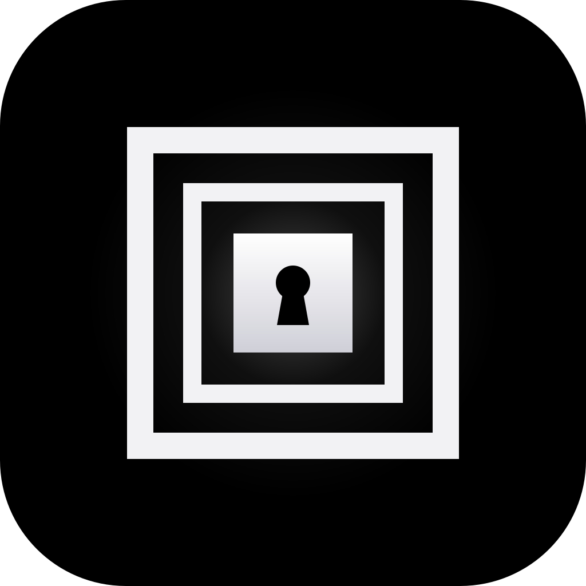
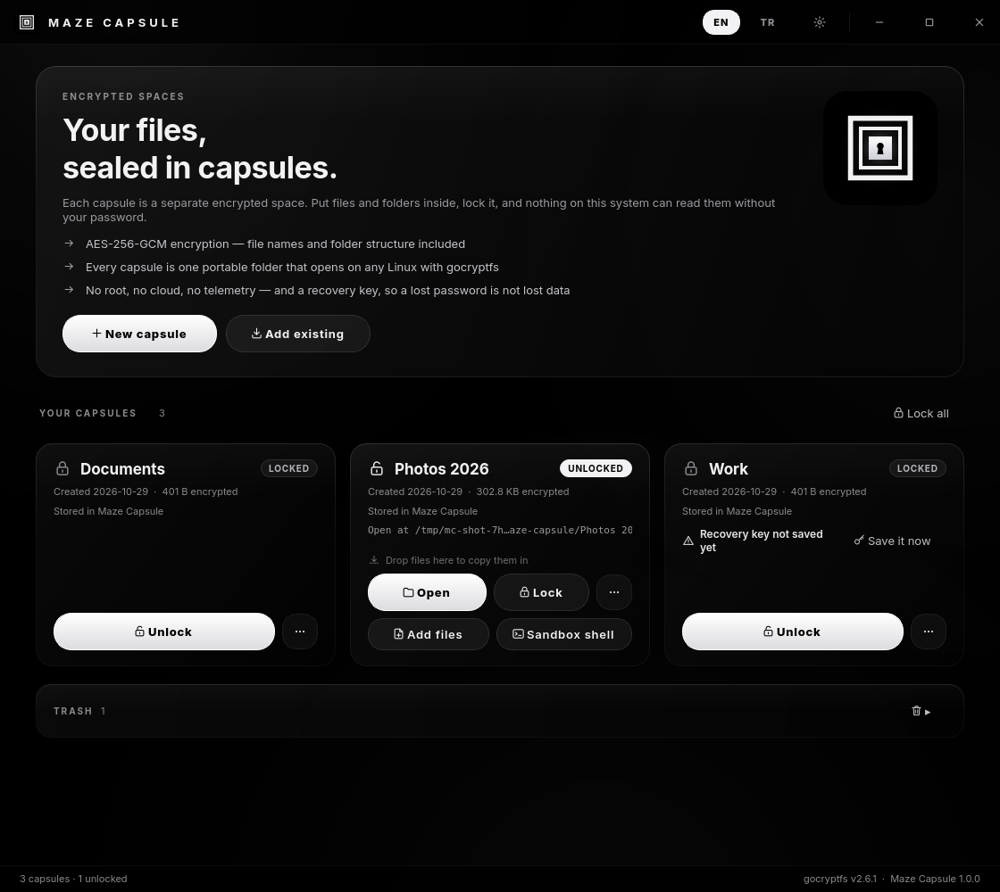
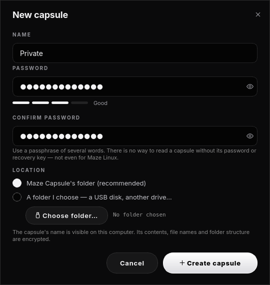
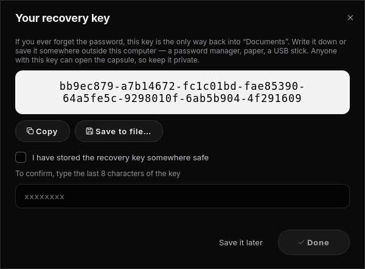
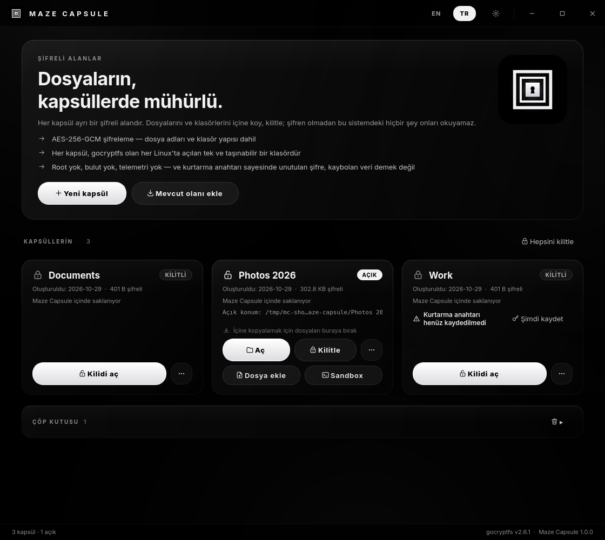

<div align="center">



# MAZE CAPSULE

**Your files, sealed in capsules**

*Separate encrypted spaces for files and folders · gocryptfs, no root · A recovery key, so a lost password is not lost data*

---

[](https://python.org)
[](https://pypi.org/project/PyQt6/)
[](https://archlinux.org)
[](https://nuetzlich.net/gocryptfs/)
[](LICENSE)

</div>

---



## What is Maze Capsule?

Maze Capsule keeps your files in **capsules**: separate encrypted spaces,
as many as you like. Create one, put files and folders inside, lock it, and
nothing on the system can read them without your password, not even their
names.

- **Every capsule is independent.** It has its own password and its own
  key, and it lives in one folder. Copy that folder to a USB disk or another
  machine and it still opens, with Maze Capsule or with nothing but
  `gocryptfs` (see `README.txt` inside every capsule).
- **No root, ever.** Capsules are mounted through FUSE as your own user.
  Maze Capsule never asks for a password other than the capsule's own.
- **Sandbox shell.** Opens a terminal that lives *inside* one unlocked
  capsule. It runs under bubblewrap with no network, a read-only system and
  a private `/tmp`; your real home and your other capsules are not visible.
- **English by default, Türkçe one click away** (title bar, or `--lang=tr`).

| | |
|---|---|
| Encryption | gocryptfs 2: AES-256-GCM contents, EME-encrypted file names, scrypt (N=2¹⁷) password hashing |
| Where capsules live | `~/.local/share/maze-capsule/capsules/<id>/`, or any folder you choose |
| Where they open | `$XDG_RUNTIME_DIR/maze-capsule/<name>/` (a private tmpfs, gone after logout) |
| Recovery | A 64-character recovery key, shown once and confirmed at creation |
| Privileges | None: user-level FUSE and bubblewrap |

## Your data does not get lost

Stability was the first requirement. Every operation is designed so that a
bug, a crash or a power cut cannot destroy files:

1. **Nothing is deleted by accident.** "Delete" moves a capsule to Maze
   Capsule's trash: one rename on the same disk, still encrypted, restorable.
   Real deletion exists only in the trash, only for a capsule that is not
   open, and only after you type its name. Removing a capsule kept on a USB
   disk only removes it from the list; the folder stays.
2. **Two copies of the key.** Each capsule keeps a second copy of its
   password-wrapped key in `key-backup/`. If the copy inside the vault is
   damaged, Maze Capsule uses the backup on its own. If both are gone, the
   recovery key still opens the capsule.
3. **Verified password changes.** Changing a password does not re-encrypt any
   file. The new password has to unwrap the same master key before the change
   is kept; otherwise the previous key file is restored.
4. **Copy, never move, and never overwrite.** Files you add are copied to a
   hidden `.part` file, flushed to disk and only then given their name. An
   existing file is never replaced (you get `name (2).ext`). Cancelling
   leaves no half files, and the originals stay where they were.
5. **Atomic metadata.** Every metadata file is written to a temp file,
   fsync'ed and renamed into place, with a `.bak` of the previous version.
6. **The kernel is the source of truth.** Whether a capsule is unlocked is
   read from `/proc/self/mountinfo`, never remembered by the app. gocryptfs
   runs as its own daemon, so a crash or a closed window does not interrupt a
   write, and the capsule is found again on the next start.
7. **Locking never cuts a write short.** If a program still has files open,
   locking refuses. You can choose "Lock when closed" instead, which detaches
   the capsule and finishes locking once those files close. A user service
   does the same for every capsule when your session ends.
8. **Integrity check.** "Check integrity" authenticates every file read-only
   with `gocryptfs -fsck` and changes nothing.

## Using it

| Action | How |
|---|---|
| New capsule | **New capsule**: name, password, location. The recovery key is shown next; confirm its last 8 characters. |
| Add files | Drag them onto an unlocked capsule's card, or use **Add files** / **Add folder**. |
| Open | **Open** shows the capsule's contents in your file manager. Everything saved there is encrypted. |
| Lock | **Lock** on the card, **Lock all** (`Ctrl+L`), or the *Lock all capsules* action of the menu entry. |
| Forgot the password | Unlock → *Use the recovery key*, then set a new password. |
| Back up | ⋯ → **Export backup** writes one `.capsule.tar`, still encrypted. Import it with **Add existing**. |
| USB disk | Create the capsule in a folder on the disk, or **Add existing → Add a capsule folder**. |
| Sandbox | **Sandbox** opens a shell confined to the capsule (network can be allowed in Settings). |

Command line (no GUI):

```bash
maze-capsule --list
maze-capsule --lock-all --lazy
```

### Without Maze Capsule

Every capsule carries a `README.txt` with these commands:

```bash
gocryptfs <capsule>/vault ~/capsule                                  # open
fusermount3 -u ~/capsule                                             # lock
gocryptfs -masterkey=stdin <capsule>/vault ~/capsule                 # recovery key
gocryptfs -config <capsule>/key-backup/gocryptfs.conf <capsule>/vault ~/capsule
```

## What it does not protect against

- **The capsule's name and approximate size are visible.** Contents, file
  names and folder structure are encrypted; the number and size of encrypted
  files are not hidden.
- **While a capsule is unlocked, programs running as you can read it.** That
  is what unlocked means. Lock capsules you are not using, or set an
  auto-lock time.
- **Weak passwords.** scrypt slows guessing down but cannot make a short
  password strong. Use a passphrase of several words.

## Screenshots

| New capsule | Recovery key | Türkçe |
|---|---|---|
|  |  |  |

## Building

```bash
./build-pkg.sh               # runs the tests, then makepkg → dist-pkg/
sudo pacman -U dist-pkg/maze-capsule-*.pkg.tar.zst
```

The tests create, unlock, damage and recover real gocryptfs capsules, all
inside temporary folders:

```bash
QT_QPA_PLATFORM=offscreen /opt/maze/venv/bin/python3 -m unittest discover -s tests -v
```

## License

GPL-3.0-or-later. See [LICENSE](LICENSE).
